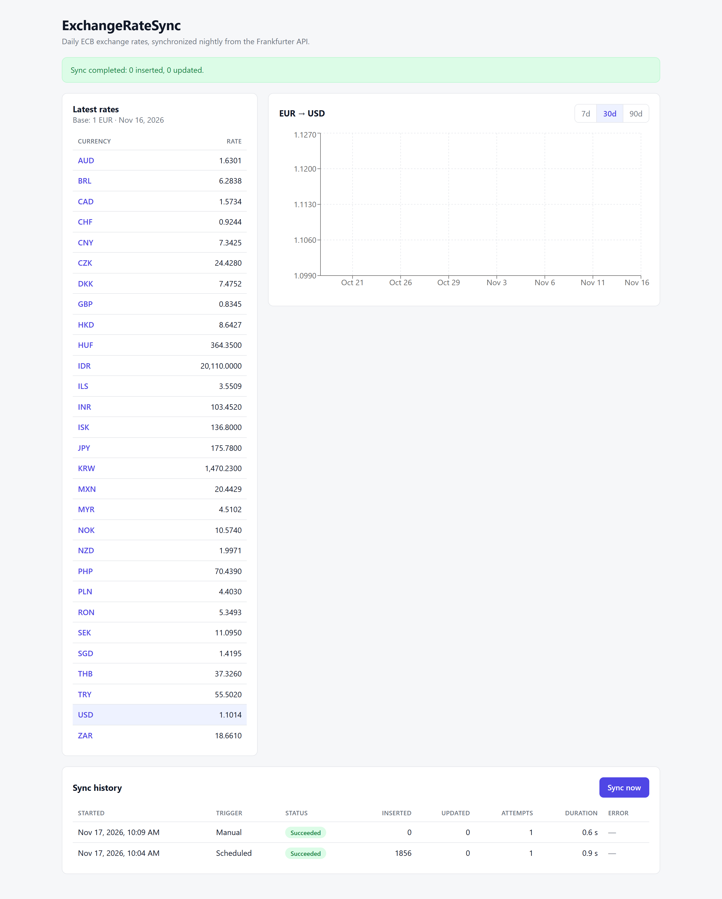
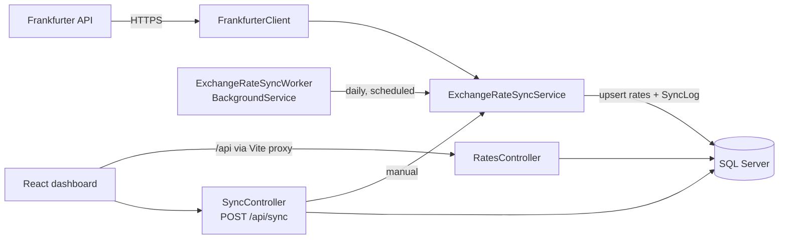
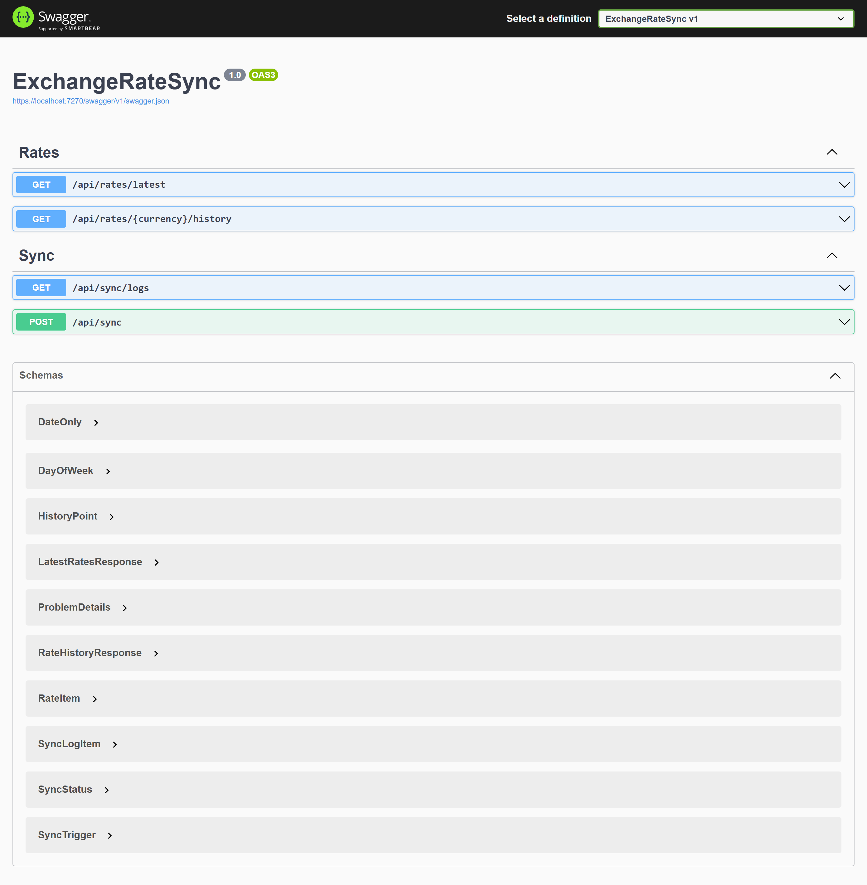

# ExchangeRateSync

A small full-stack service that synchronizes daily European Central Bank exchange rates from the [Frankfurter API](https://frankfurter.dev/) into SQL Server every night, and shows them in a React dashboard.

It is built as a realistic example of a **scheduled data integration**: retries on transient failures, idempotent upserts, a persisted sync history and a manual trigger with concurrency protection.



## Features

- **Nightly scheduled sync** using a .NET `BackgroundService` (default: 00:30 UTC).
- **Catch-up on startup**: if the last scheduled run was missed (e.g. the server was down), the sync runs immediately. On an empty database this loads the last 90 days.
- **Idempotent upsert**: a rate is inserted once per currency pair and day, updated only if the ECB corrects it, and otherwise left untouched. A unique index enforces this at the database level.
- **Retry with backoff** for transient HTTP errors and timeouts (configurable attempts and delay).
- **Sync history**: every run is logged with status, trigger, inserted/updated counts, attempt count, duration and error message.
- **Manual sync** endpoint and button, protected against concurrent runs (`409 Conflict`).
- **Interrupted run recovery**: runs left in `Running` state by a shutdown are marked as failed on the next startup.
- **REST API** with Swagger UI and RFC 7807 `ProblemDetails` error responses.
- **React dashboard**: latest rates table, rate history chart (7/30/90 days) and sync history.

## Tech stack

| Layer    | Technology                                                      |
| -------- | --------------------------------------------------------------- |
| Backend  | ASP.NET Core 8 Web API, C# 12                                   |
| Data     | Entity Framework Core 8, SQL Server (LocalDB)                   |
| HTTP     | Typed `HttpClient` via `IHttpClientFactory`                     |
| Jobs     | `BackgroundService` (no external scheduler)                     |
| Frontend | React 19, TypeScript, Vite, Recharts                            |

## Architecture



### How a sync run works

1. Acquire an in-process lock so that only one sync runs at a time.
2. Create a `SyncLog` entry with status `Running`.
3. Determine the date range: from the latest stored date (re-fetched in case of ECB corrections) to today, or the last 90 days if the database is empty.
4. Call the Frankfurter time-series endpoint, retrying transient failures.
5. Upsert the rates and close the log entry **in a single `SaveChanges` call**, so rates and log are committed in one transaction.
6. On failure, discard pending rate changes and save only the failed log entry with its error message.

## API

| Method | Endpoint                               | Description                                   |
| ------ | -------------------------------------- | --------------------------------------------- |
| GET    | `/api/rates/latest`                    | All rates for the most recent available date  |
| GET    | `/api/rates/{currency}/history?days=30`| Daily history of one currency (1–365 days)    |
| GET    | `/api/sync/logs?take=20`               | Most recent sync runs, newest first           |
| POST   | `/api/sync`                            | Run a sync now (`409` if one is already running) |



## Getting started

### Prerequisites

- [.NET 8 SDK](https://dotnet.microsoft.com/download/dotnet/8.0)
- SQL Server LocalDB (installed with Visual Studio) or any SQL Server instance
- Node.js 20.19+ (for the React client)

### 1. Run the API

```bash
cd ExchangeRateSync

# Restores the project-local dotnet-ef tool (version 8)
dotnet tool restore

# Creates the database
dotnet ef database update

dotnet run --launch-profile https
```

Swagger UI: `https://localhost:7270/swagger`

On first start, the worker detects the empty database and loads the last 90 days of rates.

### 2. Run the React client

```bash
cd client
npm install
npm run dev
```

Dashboard: `http://localhost:5173`

During development, Vite proxies `/api` requests to the API (see `client/vite.config.ts`), so no CORS configuration is needed.

## Configuration

All settings are in `ExchangeRateSync/appsettings.json`.

| Setting                                | Default                             | Description                                  |
| -------------------------------------- | ----------------------------------- | -------------------------------------------- |
| `ConnectionStrings:DefaultConnection`  | LocalDB                             | SQL Server connection string                 |
| `Frankfurter:BaseUrl`                  | `https://api.frankfurter.dev/v1/`   | Frankfurter API base URL                     |
| `Sync:BaseCurrency`                    | `EUR`                               | Base currency of the stored rates            |
| `Sync:DailyRunTimeUtc`                 | `00:30`                             | Daily run time (UTC)                         |
| `Sync:InitialBackfillDays`             | `90`                                | Days loaded when the database is empty       |
| `Sync:MaxRetryAttempts`                | `3`                                 | Attempts per run for transient errors        |
| `Sync:RetryDelaySeconds`               | `30`                                | Delay between attempts                       |

## Project structure

```
ExchangeRateSync/
├── ExchangeRateSync/          ASP.NET Core Web API
│   ├── Clients/               Frankfurter typed HttpClient
│   ├── Controllers/           Rates and Sync endpoints (+ response DTOs)
│   ├── Data/                  AppDbContext (Fluent API configuration)
│   ├── Entities/              ExchangeRate, SyncLog
│   ├── Migrations/            EF Core migrations
│   └── Services/              Sync service and scheduled worker
├── client/                    React + TypeScript dashboard (Vite)
└── docs/screenshots/
```

## Design decisions

- **No scheduler library.** A single daily job does not justify Quartz.NET or Hangfire; a `BackgroundService` that waits until the next run time is enough. For multiple jobs, cron expressions or a dashboard, Hangfire or Quartz.NET would be the better choice.
- **Database-level idempotency.** The upsert logic avoids duplicates, and the unique index on `(BaseCurrency, TargetCurrency, Date)` guarantees it even if the code is wrong.
- **Failed syncs return `200`.** A failed run is a business result, not an API error; it is reported in the response body and the sync history.
- **Single-instance assumption.** The sync lock and the interrupted-run recovery are in-process. Running multiple instances would require a distributed lock (e.g. SQL Server `sp_getapplock` or Redis).
- **Frankfurter v1.** The v1 API is marked as deprecated in favour of v2 but remains available; migrating is listed below.

## Possible improvements

- Unit and integration tests (sync service with a mocked `HttpMessageHandler`, Testcontainers for SQL Server)
- `docker-compose` setup with SQL Server for non-Windows environments
- Migration to the Frankfurter v2 API
- Health check endpoint reporting the last successful sync
- Serving the React build from the API for a single deployable unit

## License

MIT